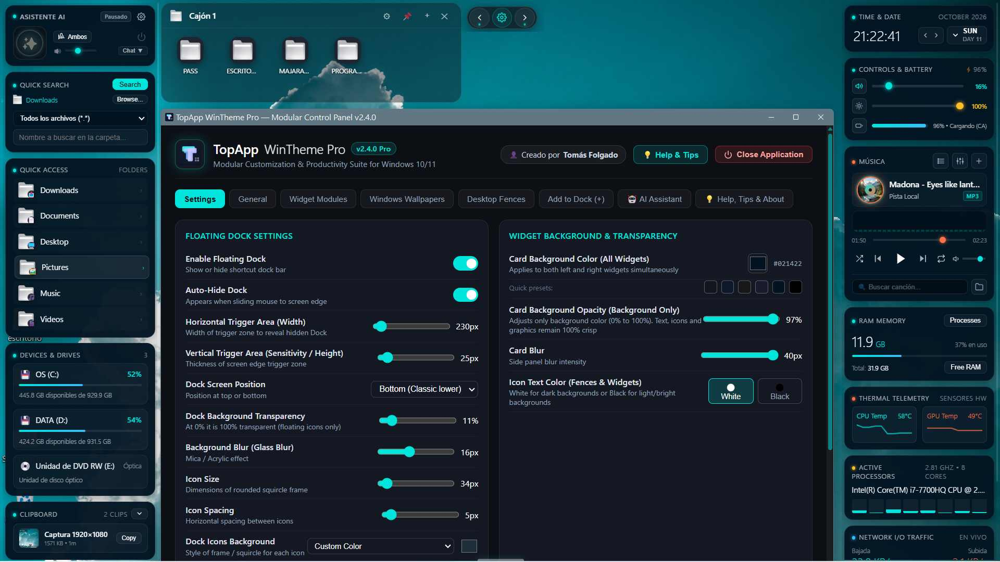
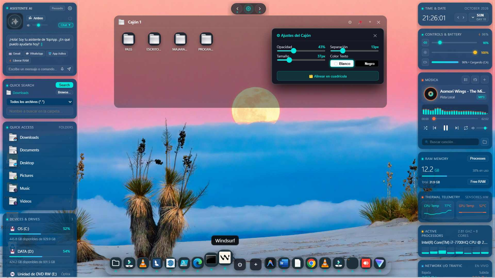
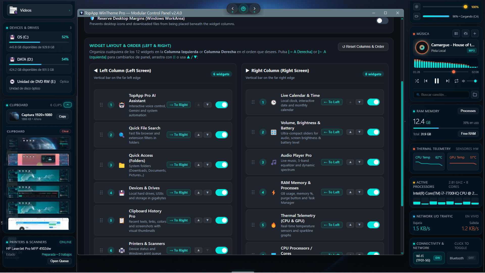
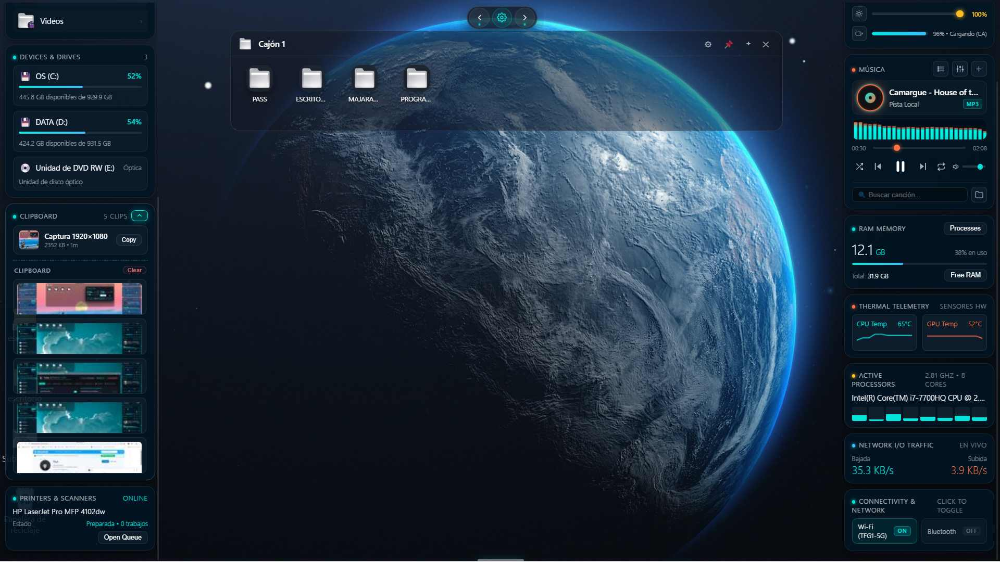
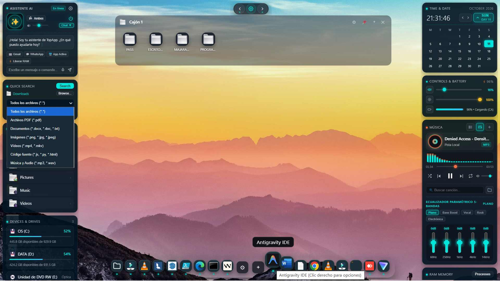

# TopApp WinTheme Pro

> Suite modular de personalización y productividad para Windows 10 y 11.  
> Autor: Tomás Folgado.  
> 🌐 *Idioma / Language:* **Español** | [English](README.md)

[](https://github.com/tomasfolgado/topapp-wintheme-pro/releases/latest)

[](https://github.com/tomasfolgado/topapp-wintheme-pro/releases/latest)
[](https://github.com/tomasfolgado/topapp-wintheme-pro/releases)
[](LICENSE)
[](https://github.com/tomasfolgado/topapp-wintheme-pro/releases/latest)
[](https://www.electronjs.org/)

---

## 📸 Interfaz y Capturas de Pantalla

| Barra Dock y Widgets Flotantes | Panel de Control (Hub) |
|:---:|:---:|
|  |  |

| Cajones de Escritorio (Fences) | Telemetría y Personalización |
|:---:|:---:|
|  |  |

<p align="center">
  
</p>

---

## Descarga e Instalación Rápida

1. Descarga el paquete de instalación ejecutable:  
   👉 **[TopApp WinTheme Pro Setup 2.4.0.exe (Descarga Directa)](https://github.com/tomasfolgado/topapp-wintheme-pro/releases/latest)**
2. Ejecuta el archivo descargado y sigue los sencillos pasos del instalador.
3. El programa creará automáticamente sus accesos directos y estará listo para usarse.

---

## Características

### Panel de Control Modular
- Interfaz flotante con efecto Glassmorphism translúcido, desenfoque regulable y ajuste de opacidad en tiempo real.
- Selector de color de texto de iconos y widgets (blanco / negro) adaptable a cualquier fondo de escritorio.
- Selector de color de acento y calibración global de transparencias.

### Reproductor de Audio
- Procesamiento de audio con Web Audio API y decodificación de metadatos ID3v2 APIC.
- Disco de vinilo interactivo con ampliación flotante de carátula en formato cuadrado de 150×150 px al pasar el ratón.
- Ecualizador paramétrico de 5 bandas con preajustes tonales integrados.
- Espectro visualizador dual animado a 60 FPS.
- Cajón de lista de reproducción con filtrado y búsqueda en tiempo real.

### Fondos de Pantalla de Windows
- Colección fotográfica de alta resolución procedente de la comunidad Unsplash bajo licencia abierta.
- Selector de imágenes locales para aplicar fondos personalizados en Windows mediante SystemParametersInfo.
- Generador de degradados suaves con paletas neutras de baja saturación (pizarra, carbón, grafito).

### Dock de Aplicaciones
- Barra de accesos directos flotante con efecto de escala gradual (Wave Zoom).
- Configuración de márgenes, escala, radio de acción y ocultación automática.
- Gestión de aplicaciones, carpetas y ejecutables.

### Cajones de Escritorio (Fences)
- Contenedores translúcidos organizadores de iconos con anclaje al escritorio.
- Ajuste independiente de geometría, orden de elementos y nivel de opacidad.

### Widgets de Telemetría
- Monitor de memoria RAM con gráfica de tendencia continua e instrucción de purga.
- Monitor térmico y de ventiladores para CPU y GPU.
- Matriz de carga para procesadores multinúcleo (hasta 16 hilos).
- Monitor de estado de cola de impresión.
- Historial dinámico de portapapeles.
- Buscador rápido con filtros por extensión y categoría de documento.

---

## Ejecución desde Código Fuente (Desarrolladores)

Requisitos: Windows 10/11 x64 y Node.js 18 o superior.

```bash
git clone https://github.com/tomasfolgado/topapp-wintheme-pro.git
cd topapp-wintheme-pro
npm install
npm start
```

### Compilación del Instalador
```bash
npm run dist
```
El instalador generado se ubicará en el directorio `release/`.

---

## Licencia y Términos Legales

Este proyecto se distribuye como Software Libre bajo los términos de la Licencia MIT.

Aviso legal: El software se proporciona "tal cual", sin garantías de ninguna clase, explícitas o implícitas. El autor, Tomás Folgado, y los colaboradores quedan exentos de toda responsabilidad civil, penal, económica o administrativa derivada del uso, instalación, ejecución o modificación del programa. El usuario asume voluntariamente todos los riesgos asociados a su utilización.

---

## Créditos
- Fotografías de muestra proporcionadas por la comunidad de Unsplash.
- Desarrollado sobre la plataforma Electron.
